<div align="center">

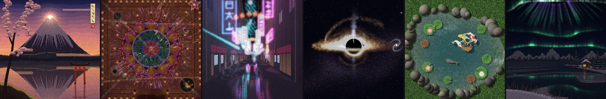

# Pointillist Animations

**Twenty procedural animations painted entirely in dots: flowers, landscapes, neon cities, a black hole,
Mount Fuji and Diwali, each a one-minute film drawn live by Python and NumPy. Plus a 3D rose that blooms in your terminal.**

[](https://www.python.org/)
[](https://numpy.org/)
[](https://python-pillow.org/)
[](https://docs.python.org/3/library/tkinter.html)
[](#gallery)
[](LICENSE)

[Gallery](#gallery) · [Quick start](#quick-start) · [Run each animation](#running-the-animations) · [How it works](#how-it-works) · [Engine docs](docs/ENGINE.md) · [All animations](docs/ANIMATIONS.md)

</div>

---

## Overview

Every frame of every animation here is built from tens of thousands of small round dots: opaque dots for
petals, stone and steel, and light dots that add up into glare, neon, fireflies and fireworks. Nothing is
pre-rendered and there are no image assets. Each scene is a single Python file that computes its picture
for any moment `t` directly, so it plays live in a window, jumps or restarts instantly, and exports any
moment, or the whole film, exactly the same every time.

The collection comes in four parts:

| Set | What it is | Count |
|---|---|:---:|
| **[Garden](#garden)** | Flowers and landscapes, from a sunflower's summer day to a black hole, Mount Fuji and Diwali | 13 |
| **[Neon](#neon)** | Cyberpunk, synthwave and dieselpunk cities, with a small neon-light toolkit | 5 |
| **[Dandelion](#dandelion)** | A dandelion's whole life, at night, sunset and a dewy sunrise | 1 (3 themes) |
| **[ASCII rose](#ascii-rose)** | A 3D rose that blooms in your terminal, in 24-bit colour | 1 |

## Features and highlights

- **Pure pointillism.** Every surface and every light is made of dots; light dots are additive, so glows,
  reflections and bloom build up naturally.
- **One-minute stories and seamless loops.** Fourteen pieces are stories with a beginning and an end;
  five loop forever without a visible seam (koi pond, glowing beach, kelp forest, Mount Fuji, synthwave drive).
- **Deterministic and stateless.** `render(t)` is a pure function of time with seeded randomness: pause, scrub,
  restart and export always give identical frames.
- **One shared engine.** About 600 lines in [`engine/pointillism.py`](engine/pointillism.py): dot stamping,
  additive light, a soft-light grid for halos and bloom, cross-faded backdrops, sun and moon sprites,
  and the window and exporters.
- **Live window plus exports.** Every animation opens a Tk window (Space, R, S, Esc) and can save five
  stage frames (`--png`) or the whole film as a GIF (`--gif`).
- **Real phenomena, carefully staged.** Gravitational lensing and an Einstein ring, Diamond Fuji and Akafuji,
  synchronous fireflies, bioluminescent surf, a light echo, a rangoli that pours itself and then rises into fireworks.
- **Small dependency footprint.** NumPy and Pillow; the window uses the standard library's tkinter.

<a id="gallery"></a>
## Gallery

Each preview is a 5-second clip of the animation's signature moment (360 px, 10 fps). The full-size
animations run at your window size. Five-stage strips of each whole minute are in
[docs/ANIMATIONS.md](docs/ANIMATIONS.md).

<a id="garden"></a>
### Garden

| | | |
|:---:|:---:|:---:|
| 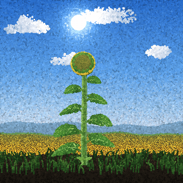<br>**[Sunflower](docs/ANIMATIONS.md#sunflower)**<br><sub>one summer day, seed to seed</sub> | 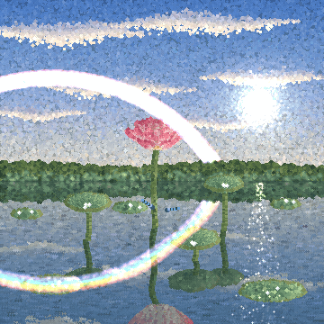<br>**[Lotus](docs/ANIMATIONS.md#lotus)**<br><sub>summer rain, a rainbow, the bloom</sub> | 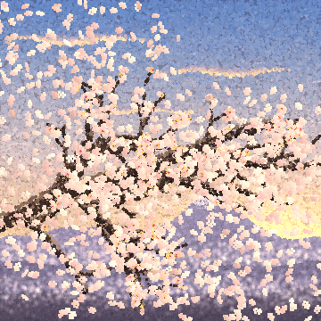<br>**[Sakura](docs/ANIMATIONS.md#sakura)**<br><sub>winter snow to a storm of petals</sub> |
| 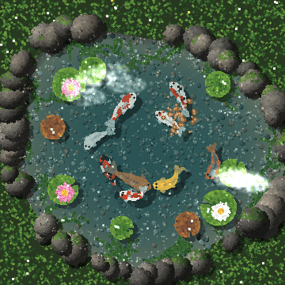<br>**[Koi pond](docs/ANIMATIONS.md#koi-pond)**<br><sub>top-down, seamless loop</sub> | 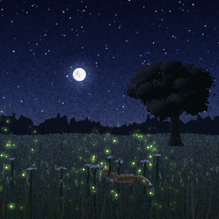<br>**[Firefly meadow](docs/ANIMATIONS.md#fireflies)**<br><sub>flashes that fall into step; a fox</sub> | 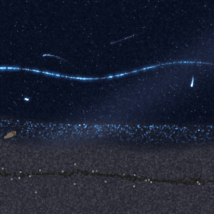<br>**[Glowing beach](docs/ANIMATIONS.md#glow-beach)**<br><sub>bioluminescent surf, seamless loop</sub> |
| 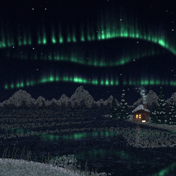<br>**[Northern lights](docs/ANIMATIONS.md#aurora)**<br><sub>curtains, a crown, a frozen lake</sub> | 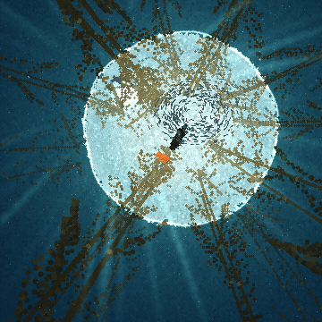<br>**[Kelp forest](docs/ANIMATIONS.md#kelp)**<br><sub>looking up; a seal and a school, loop</sub> | 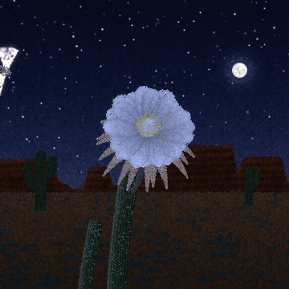<br>**[Queen of the Night](docs/ANIMATIONS.md#night-bloom)**<br><sub>a one-night cactus bloom, a hawk moth</sub> |
| 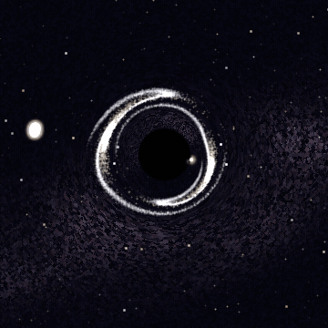<br>**[Black hole](docs/ANIMATIONS.md#black-hole)**<br><sub>a star torn apart; lensing and a disk</sub> | 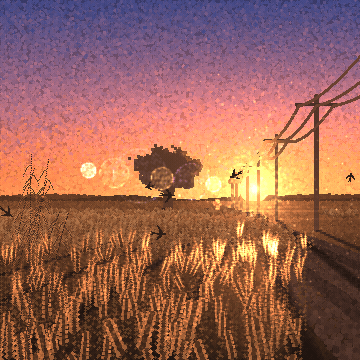<br>**[Golden hour](docs/ANIMATIONS.md#golden-hour)**<br><sub>backlit wheat and endless shadows</sub> | 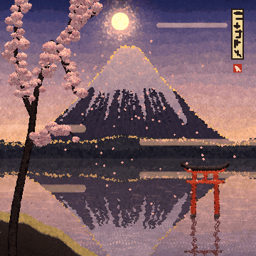<br>**[Mount Fuji](docs/ANIMATIONS.md#fuji)**<br><sub>a living woodblock print, seamless loop</sub> |
| 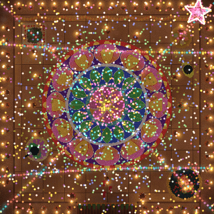<br>**[Diwali night](docs/ANIMATIONS.md#diwali)**<br><sub>rangoli, diyas, sparklers, fireworks</sub> | | |

<a id="neon"></a>
### Neon

| | | |
|:---:|:---:|:---:|
| 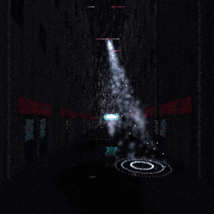<br>**[Neon alley](docs/ANIMATIONS.md#neon-alley)**<br><sub>rain, a blackout, a cascade of neon</sub> | 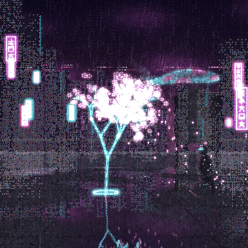<br>**[Hologram sakura](docs/ANIMATIONS.md#holo-sakura)**<br><sub>a tree of light that glitches</sub> | 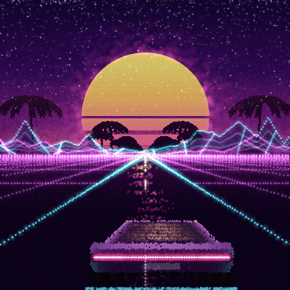<br>**[Synthwave drive](docs/ANIMATIONS.md#synthwave-drive)**<br><sub>an endless night drive, loop</sub> |
| 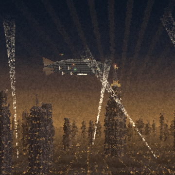<br>**[Zeppelin harbour](docs/ANIMATIONS.md#zeppelin-harbor)**<br><sub>dieselpunk docking at the mast</sub> | 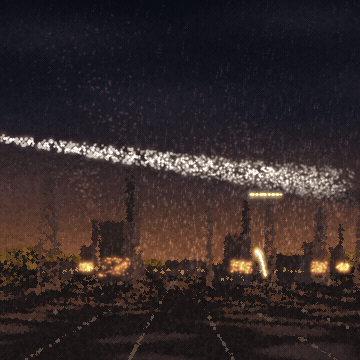<br>**[Iron streamliner](docs/ANIMATIONS.md#iron-streamliner)**<br><sub>an armoured train over a mill town</sub> | |

<a id="dandelion"></a>
### Dandelion

| Night | Sunset | Sunrise |
|:---:|:---:|:---:|
| 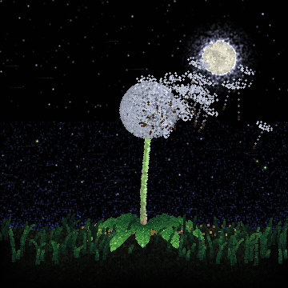 | 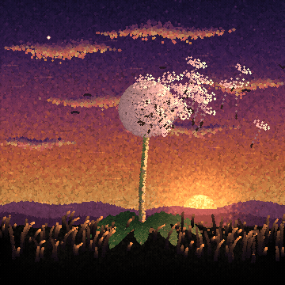 | 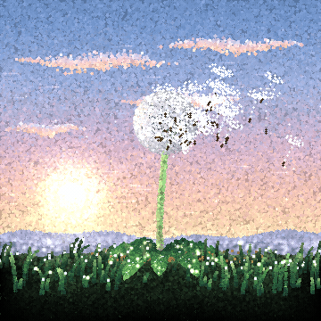 |

<a id="ascii-rose"></a>
### ASCII rose

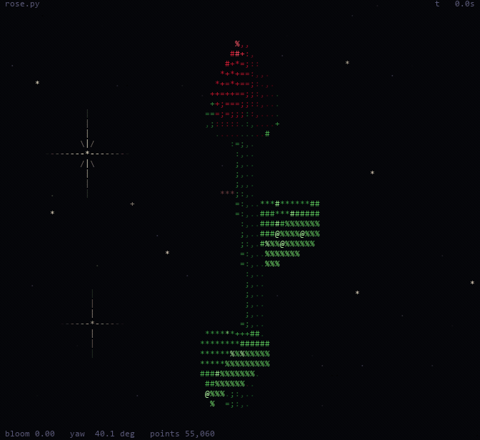

<details>
<summary><b>Five-stage strips of every animation</b> (click to expand)</summary>

<br>

| Animation | The whole minute in five frames |
|---|---|
| Sunflower | 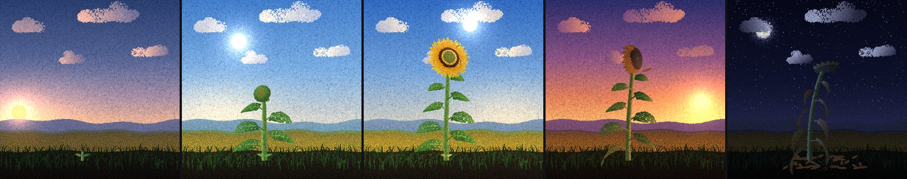 |
| Lotus | 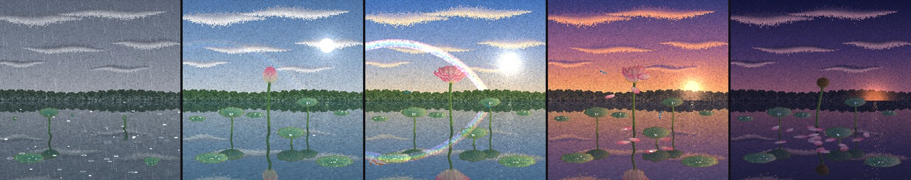 |
| Sakura |  |
| Koi pond | 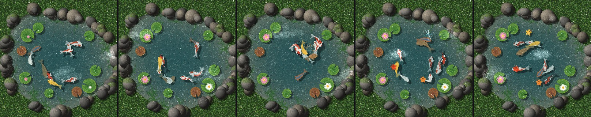 |
| Firefly meadow | 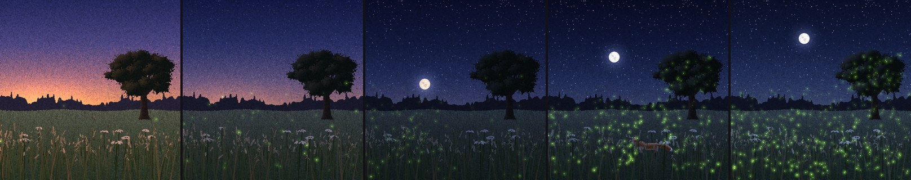 |
| Glowing beach | 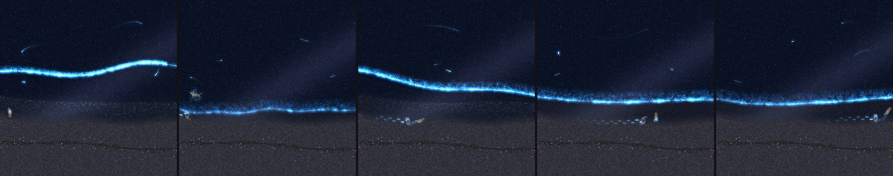 |
| Northern lights | 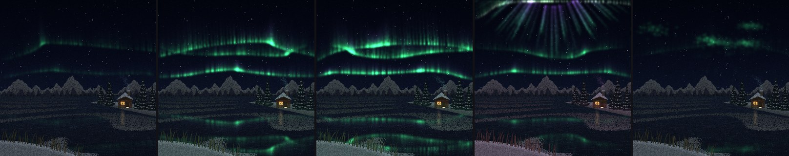 |
| Kelp forest | 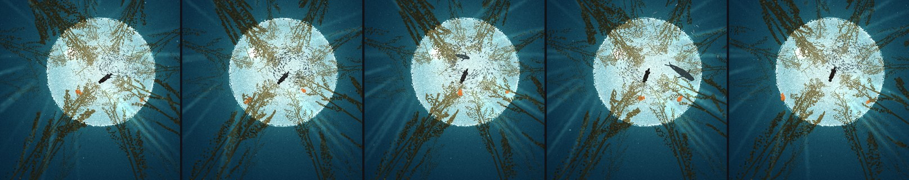 |
| Queen of the Night | 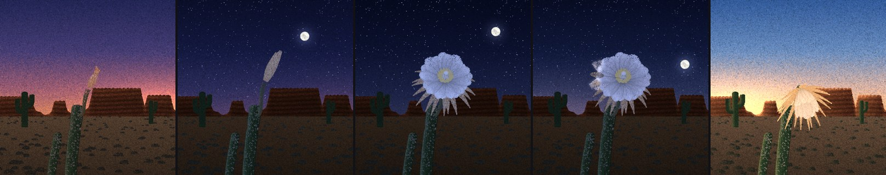 |
| Black hole | 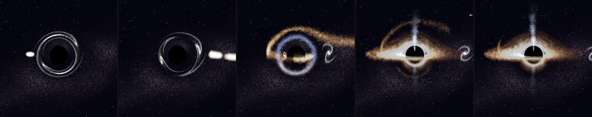 |
| Golden hour | 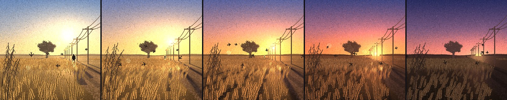 |
| Mount Fuji |  |
| Diwali night | 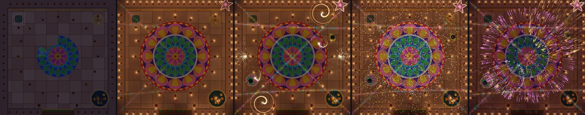 |
| Neon alley | 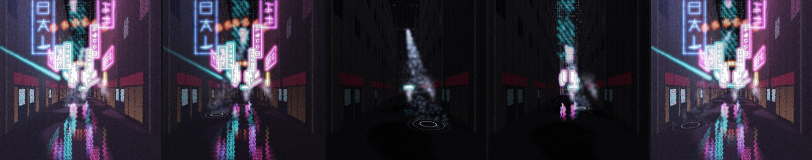 |
| Hologram sakura | 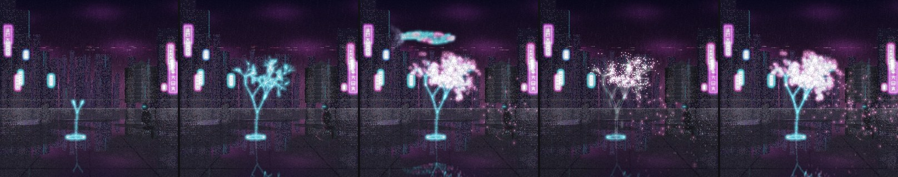 |
| Synthwave drive | 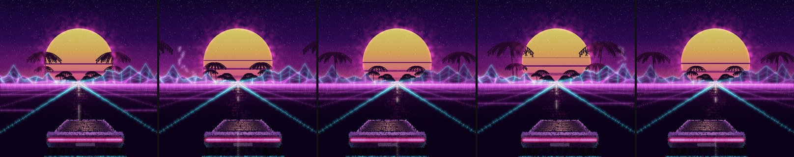 |
| Zeppelin harbour | 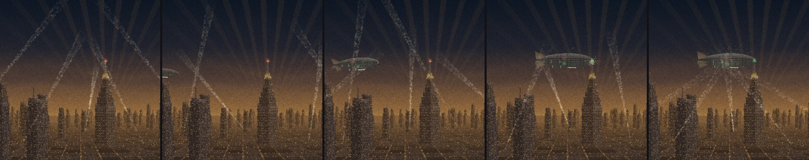 |
| Iron streamliner | 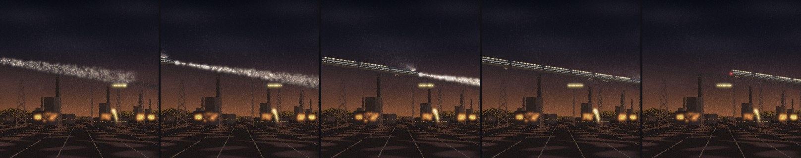 |
| Dandelion (night) | 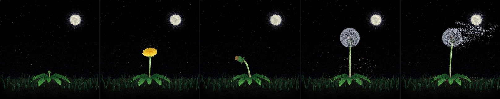 |
| Dandelion (sunset) | 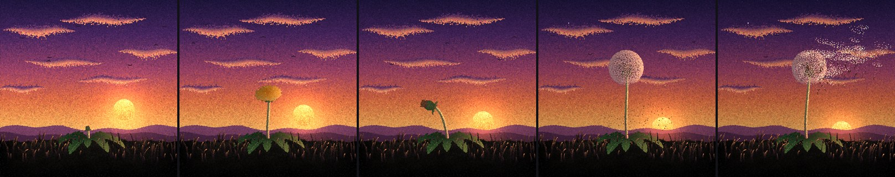 |
| Dandelion (sunrise) | 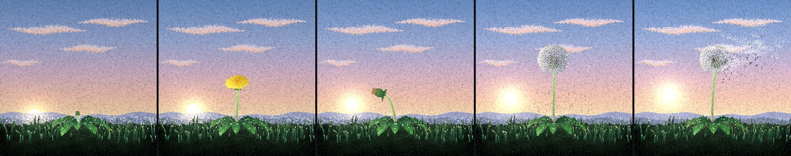 |
| ASCII rose | 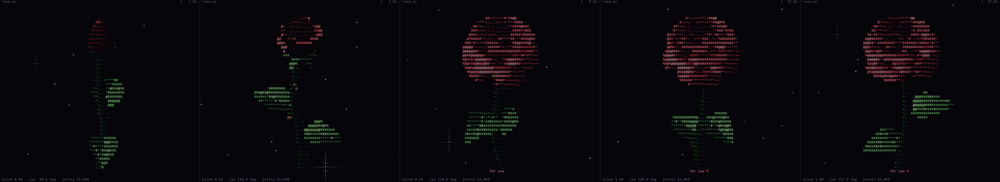 |

</details>

## Technologies

| Technology | Role |
|---|---|
| [Python 3](https://www.python.org/) | Everything. Developed and tested with Python 3.15.0 |
| [NumPy](https://numpy.org/) | All drawing: vectorised dot footprints, additive light with `bincount`, geometry and particles (tested with 2.5.4) |
| [Pillow](https://python-pillow.org/) | Frame conversion for the window, PNG and GIF export, upsampling the soft-light grid (tested with 13.0.0) |
| [tkinter](https://docs.python.org/3/library/tkinter.html) | The live window (standard library) |
| [FFmpeg](https://ffmpeg.org/) *(optional)* | Only for `tools/make_previews.py`, to encode the README previews; it falls back to Pillow without it |

## Architecture

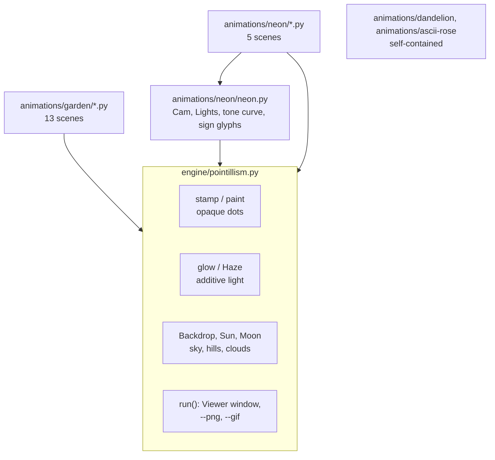

Each scene is a class with `__init__(W, H)`, which builds everything that never changes, and `render(t)`,
which returns a `uint8` frame for time `t`. It is handed to `run()`, which provides the window and the
exporters. The full engine reference, the frame pipeline and a guide to writing a new scene are in
**[docs/ENGINE.md](docs/ENGINE.md)**.

<a id="quick-start"></a>
## Installation

```bash
git clone https://github.com/Carcus0013/pointillist-animations.git
cd pointillist-animations

python -m venv .venv
# Windows:            .venv\Scripts\activate
# macOS / Linux:      source .venv/bin/activate

pip install -r requirements.txt
```

Then open an animation:

```bash
python animations/garden/fuji.py
```

## Dependencies and requirements

| Requirement | Notes |
|---|---|
| Python 3 with tkinter | Tested with 3.15.0 on Windows 11. tkinter ships with the python.org installers; on Linux it is a separate package (see [Troubleshooting](#troubleshooting)) |
| `numpy` | Tested with 2.5.4 |
| `Pillow` | Tested with 13.0.0 |
| A truecolor terminal | Only for the ASCII rose's colour (Windows Terminal, iTerm2, most Linux terminals); `--no-color` works anywhere |
| FFmpeg | Optional, only for regenerating the README previews |

## Running the animations

Run from the repository root (or anywhere: each script finds the engine relative to its own location).

| Animation | Command | Length | Type |
|---|---|:---:|:---:|
| Sunflower | `python animations/garden/sunflower.py` | 60 s | story |
| Lotus | `python animations/garden/lotus.py` | 60 s | story |
| Sakura | `python animations/garden/sakura.py` | 60 s | story |
| Koi pond | `python animations/garden/koi_pond.py` | 60 s | loop |
| Firefly meadow | `python animations/garden/fireflies.py` | 60 s | story |
| Glowing beach | `python animations/garden/glow_beach.py` | 60 s | loop |
| Northern lights | `python animations/garden/aurora.py` | 60 s | story |
| Kelp forest | `python animations/garden/kelp.py` | 60 s | loop |
| Queen of the Night | `python animations/garden/night_bloom.py` | 60 s | story |
| Black hole | `python animations/garden/black_hole.py` | 60 s | story |
| Golden hour | `python animations/garden/golden_hour.py` | 60 s | story |
| Mount Fuji | `python animations/garden/fuji.py` | 60 s | loop |
| Diwali night | `python animations/garden/diwali.py` | 60 s | story |
| Neon alley | `python animations/neon/neon_alley.py` | 60 s | story |
| Hologram sakura | `python animations/neon/holo_sakura.py` | 60 s | story |
| Synthwave drive | `python animations/neon/synthwave_drive.py` | 60 s | loop |
| Zeppelin harbour | `python animations/neon/zeppelin_harbor.py` | 60 s | story |
| Iron streamliner | `python animations/neon/iron_streamliner.py` | 60 s | story |
| Dandelion | `python animations/dandelion/dandelion.py [--theme night\|sunset\|sunrise]` | 54 s | story |
| ASCII rose | `python animations/ascii-rose/rose.py` | open-ended | terminal |

*Story* pieces play once and hold their last frame (press **R** to watch again); *loops* run forever.

## Configuration

**Window keys** (every pointillist animation):

| Key | Action |
|:---:|---|
| `Space` | pause / resume |
| `R` | restart from the beginning |
| `S` | save the current frame as `<name>_frame.png` |
| `Esc` | quit |

**Command-line flags** (every pointillist animation):

| Flag | Output | Details |
|---|---|---|
| *(none)* | live window | a square about 92% of the screen height, playing in real time |
| `--png` | `<name>_1.png` ... `<name>_5.png`, `<name>_stages.png` | the five stage moments at 1000 x 1000, plus a 2500 x 500 strip |
| `--gif` | `<name>.gif` | the whole film at 640 x 640, 12 fps (loops repeat cleanly) |
| `--theme night\|sunset\|sunrise` | | dandelion only; `dandelion_sunset.py` and `dandelion_sunrise.py` are shortcuts |

Exports are written to the folder you run the command from (the `.gitignore` keeps them out of Git).

**ASCII rose options:** `--to NAME`, `--loop`, `--spin`, `--fps`, `--aspect`, `--no-hud`, `--no-color`,
`--snapshot SECONDS`, `--size WxH`. Run `python animations/ascii-rose/rose.py --help`, or see
[docs/ANIMATIONS.md](docs/ANIMATIONS.md#ascii-rose).

## Customisation

Each animation keeps its story in plain constants near the top of its file, so most changes are edits to
numbers and colours rather than code:

| To change | Look for | Example |
|---|---|---|
| the length of the film | `T_END` | `T_END = 60.0` |
| which moments `--png` saves | `STAGES` | `STAGES = [3.0, 17.0, 31.0, 44.6, 53.0]` in `fuji.py` |
| the palette and the time-of-day looks | `LOOKS`, colour lists such as `PETAL`, `GRASS`, `NEON` | `LOOKS = [dict(t=0.0, sky=[...], ...), ...]` |
| when things happen | the `phases()` dials, timeline constants | `DOCK = 48.0` in `zeppelin_harbor.py`, `SURGE, DARK0, DARK1` in `neon_alley.py` |
| what appears | lists such as `KOI`, `BURSTS`, `SHELLS`, `CURTAINS`, `RINGS` | add a firework to `BURSTS` in `diwali.py` |
| the export size or frame rate | `save_png` / `save_gif` in `engine/pointillism.py` | `save_gif(..., fps=12, size=640)` |

Any time-of-day look is a full set of colours. Add a new `dict(t=...)` to `LOOKS` and the backdrop
cross-fades through it automatically.

**Make your own scene.** [`examples/minimal_scene.py`](examples/minimal_scene.py) is a complete ~60-line
animation (a two-look sky, hills, a setting sun masked behind them, blinking fireflies) to copy and grow:

```bash
python examples/minimal_scene.py          # window
python examples/minimal_scene.py --png    # five stages
```

**Regenerate the previews** after changing a scene:

```bash
python tools/make_previews.py fuji        # assets/previews/fuji.gif and assets/images/fuji_stages.jpg
python tools/make_previews.py             # all of them
python tools/make_previews.py banner      # the banner at the top of this README
```

<a id="how-it-works"></a>
## How it works

<details>
<summary><b>Dots and light</b></summary>

<br>

A frame is a float RGB array. `stamp` paints opaque round dots (radius up to 3 px) by looking up a
precomputed table of pixel offsets sorted by distance, so a whole batch of dots becomes one index array;
colours are written as 12-byte records for speed. `paint` sorts groups of dots by depth and draws far to
near. `glow` adds light that fades toward each dot's edge; overlapping light sums with `np.bincount`
(dense) or `np.add.at` (sparse). Wide soft light (sun glare, lantern halos, neon bloom, mist) goes onto a
coarse grid, the `Haze`, which is blurred and upsampled once per frame.

</details>

<details>
<summary><b>Backdrops, looks and the timeline</b></summary>

<br>

Backgrounds that change with the time of day are built once as a few key images ("looks") from the same
random seed, so their dots line up, and `Backdrop.at(t)` cross-fades them. The story is driven by smooth
dials: `ss(t, a, b)` (smoothstep) and `keyed(t, keys)` (interpolation between `(time, value)` keys) decide
how open a petal is, how far a curtain has folded or how lit a district is. Nothing is simulated step by
step: particles (sparks, rain, petals, fireworks, seeds) follow closed-form paths from fixed launch values,
which is why any frame can be drawn on its own.

</details>

<details>
<summary><b>Geometry and cameras</b></summary>

<br>

Plants are built from parametric surfaces and curves: Bezier stems, ruled petals with cupping and curl,
the golden-angle spiral of a sunflower's florets, recursive branches. The Neon set uses a pinhole camera
(`Cam`) for its streets and rooftops. The top-down Diwali courtyard and the upward view of the kelp
forest use a perspective camera, so things nearer the lens look larger and spread outward. The black hole bends
light with point-lens optics, producing doubled images and an Einstein ring, and its accretion disk is
brighter on the side moving toward the viewer.

</details>

<details>
<summary><b>Reflections, loops and tone</b></summary>

<br>

Water and wet ground reflect by mirroring rows about the waterline with a rippling horizontal offset
(lotus, Mount Fuji, hologram sakura) or by stretching light sources into trembling streaks (neon alley).
Seamless loops use only motions that repeat a whole number of times per minute, closed paths and events
that finish inside the minute. The Neon scenes, the black hole and Diwali pass the frame through a soft
tone curve, so the hottest light turns white while its halo keeps its colour.

</details>

More detail: **[docs/ENGINE.md](docs/ENGINE.md)** (engine and toolkit reference) and
**[docs/ANIMATIONS.md](docs/ANIMATIONS.md)** (every animation, its timeline and its stages).

## Project structure

```text
pointillist-animations/
├── README.md
├── LICENSE
├── requirements.txt
├── .gitignore
├── engine/
│   └── pointillism.py          # the shared dot-painting engine, window and exporters
├── animations/
│   ├── garden/                 # 13 scenes: sunflower, lotus, sakura, koi pond, fireflies, glowing beach,
│   │                           #   northern lights, kelp, Queen of the Night, black hole, golden hour, Fuji, Diwali
│   ├── neon/                   # neon.py (camera, neon lights, tone curve) + 5 city scenes
│   ├── dandelion/              # dandelion.py and its sunset / sunrise shortcuts (self-contained)
│   └── ascii-rose/             # rose.py, the terminal rose (self-contained)
├── examples/
│   └── minimal_scene.py        # a complete starter scene
├── tools/
│   ├── make_previews.py        # builds the GIFs, stage strips and banner used here
│   └── benchmark.py            # measures frame times
├── docs/
│   ├── ENGINE.md
│   └── ANIMATIONS.md
└── assets/
    ├── images/                 # banner and five-stage strips (JPEG)
    └── previews/               # 22 preview GIFs
```

<a id="performance"></a>
## Performance

Rendering is CPU-only NumPy. Measured with `python tools/benchmark.py` (frames at 1000 x 1000, averaged
over 12 moments spread across each film) on the development machine, a Windows 11 laptop running
Python 3.15.0, NumPy 2.5.4 and Pillow 13.0.0. Expect different numbers on other hardware.

<details>
<summary><b>Frame times at 1000 x 1000</b></summary>

<br>

| Animation | ms / frame | fps | | Animation | ms / frame | fps |
|---|---:|---:|---|---|---:|---:|
| Sunflower | 42.5 | 23.5 | | Golden hour | 71.3 | 14.0 |
| Lotus | 43.2 | 23.1 | | Mount Fuji | 47.2 | 21.2 |
| Sakura | 33.9 | 29.5 | | Diwali night | 53.5 | 18.7 |
| Koi pond | 60.1 | 16.6 | | Neon alley | 65.3 | 15.3 |
| Firefly meadow | 33.2 | 30.1 | | Hologram sakura | 62.1 | 16.1 |
| Glowing beach | 34.3 | 29.2 | | Synthwave drive | 74.1 | 13.5 |
| Northern lights | 58.2 | 17.2 | | Zeppelin harbour | 42.3 | 23.6 |
| Kelp forest | 60.9 | 16.4 | | Iron streamliner | 50.7 | 19.7 |
| Queen of the Night | 35.3 | 28.3 | | Dandelion (night) | 22.3 | 44.9 |
| Black hole | 68.0 | 14.7 | | Dandelion (sunrise) | 40.3 | 24.8 |

</details>

The window draws at its own size in real time and drops frames when it can't keep up, so the film always
plays at the right speed: a smaller screen or window means more frames per second.

## Known limitations

- **CPU-bound.** Frame rates depend on the machine and the window size (13-45 fps at 1000 px on the
  development machine). There is no GPU path.
- **Sizes are set in code.** The window is ~92% of the screen height, `--png` is 1000 px and `--gif` is
  640 px at 12 fps; there are no command-line options for these yet, and the window does not re-render
  when resized.
- **Full-length GIF exports are slow and very large.** They render every frame of the minute (720 at
  12 fps) and store them with Pillow's adaptive palette and no inter-frame optimisation: the koi pond's
  takes about 80 seconds and comes to roughly 180 MB. The previews in this README were made with
  `tools/make_previews.py` instead (short clips, encoded with FFmpeg).
- **Story pieces hold their last frame** rather than looping; press **R** to restart.
- **No sound.**
- **Tested on one platform.** Everything was developed and tested on Windows 11 with Python 3.15.0. Other
  systems should work with NumPy, Pillow and tkinter installed, but have not been tested.
- **The dandelion and the ASCII rose are self-contained** and do not use the shared engine.

<a id="troubleshooting"></a>
## Troubleshooting

<details>
<summary><b><code>ModuleNotFoundError: No module named 'numpy'</code> (or <code>'PIL'</code>)</b></summary>

Activate your virtual environment and run `pip install -r requirements.txt`.
</details>

<details>
<summary><b><code>ModuleNotFoundError: No module named 'pointillism'</code></b></summary>

Each scene finds `engine/` relative to its own file. Keep the repository layout intact: don't copy a
single scene out of `animations/` on its own.
</details>

<details>
<summary><b><code>No module named 'tkinter'</code> / <code>_tkinter</code></b></summary>

The window needs tkinter. On Debian or Ubuntu: `sudo apt install python3-tk`. On Fedora: `sudo dnf install python3-tkinter`.
With Homebrew Python on macOS: `brew install python-tk`. The python.org installers for Windows and macOS include it.
`--png` and `--gif` never open the window and don't import tkinter, so exports work without it.
</details>

<details>
<summary><b>The animation looks choppy</b></summary>

It is drawn live at your window's size and keeps real time by dropping frames. Close other heavy programs,
or export with `--gif` to watch it smoothly. `python tools/benchmark.py` shows what your machine manages.
</details>

<details>
<summary><b>The ASCII rose prints escape codes or looks squashed</b></summary>

Use a terminal with 24-bit colour (Windows Terminal, iTerm2, most Linux terminals) or add `--no-color`.
Maximise the window or zoom the font out; adjust `--aspect` if your font's cells are not about twice as
tall as they are wide.
</details>

<details>
<summary><b>Where did my exported files go?</b></summary>

Into the folder you ran the command from, named after the animation (`fuji_stages.png`, `fuji.gif`, ...).
</details>

## Future improvements

Ideas that are **not implemented yet**:

- command-line options for window size, export size and frame rate;
- an MP4 exporter, far smaller than GIF for full-length films;
- a resizable window that re-renders at the new size;
- automated tests (deterministic frame checksums) and CI;
- moving the dandelion onto the shared engine;
- packaging (`pyproject.toml`) with a single launcher command.

## Contributing

Contributions are welcome: new scenes, performance work, fixes and documentation.

1. Fork the repository and create a branch (`git checkout -b my-scene`).
2. Follow the conventions in [docs/ENGINE.md](docs/ENGINE.md#writing-a-new-scene): build once in
   `__init__`, keep `render(t)` stateless, seed every random generator, scale sizes with the frame.
3. Check that it runs and exports from a scratch folder:
   `python path/to/scene.py --png` (and `--gif` for loops, to see the seam).
4. Add a preview: register the scene in `CATALOG` in `tools/make_previews.py` and run it.
5. Run `python tools/benchmark.py your_scene` and mention the numbers in your pull request.
6. Open a pull request describing what the scene shows and anything you changed in the engine.

Please keep pull requests focused: one scene or one improvement each.

## License

Released under the [MIT License](LICENSE).

## Acknowledgements

The dandelion was made in the style of the pointillist flower in
[iremcnar/Flowers](https://github.com/iremcnar/Flowers), which inspired this collection. The original
`Flowers` repository is not part of this project.
