# The animations

Every animation below is one Python file. Story pieces play once and hold their last frame
(press **R** to restart); loops wrap seamlessly. All of them accept `--png` (five stages) and
`--gif` (the whole film), and share the window keys **Space** pause, **R** restart, **S** save frame, **Esc** quit.
The descriptions are each script's own docstring.

- **Garden**: [Sunflower](#sunflower), [Lotus](#lotus), [Sakura](#sakura), [Koi pond](#koi-pond), [Firefly meadow](#fireflies), [Glowing beach](#glow-beach), [Northern lights](#aurora), [Kelp forest](#kelp), [Queen of the Night](#night-bloom), [Black hole](#black-hole), [Golden hour](#golden-hour), [Mount Fuji](#fuji), [Diwali night](#diwali)
- **Neon**: [Neon alley](#neon-alley), [Hologram sakura](#holo-sakura), [Synthwave drive](#synthwave-drive), [Zeppelin harbour](#zeppelin-harbor), [Iron streamliner](#iron-streamliner)
- **Dandelion**: [night, sunset and sunrise](#dandelion)
- **ASCII rose**: [in the terminal](#ascii-rose)

## Garden

Flowers and landscapes, each a one-minute film.

<a id="sunflower"></a>
### Sunflower

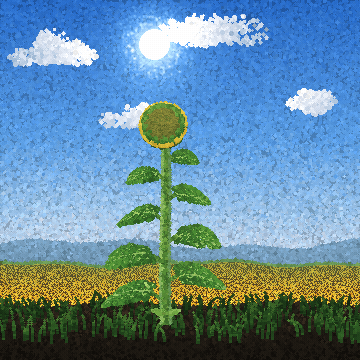

| | |
|---|---|
| **File** | [`animations/garden/sunflower.py`](../animations/garden/sunflower.py) |
| **Class** | `Sunflower` |
| **Length** | 60 s, story, plays once |
| **`--png` stages** | 3.5, 15, 30, 45, 57.5 s |
| **Preview clip** | 21-26 s |

Dawn: a seedling opens its first two leaves as the sun comes up behind the hills.
Morning: the stalk shoots up leaf by leaf and a spiky green bud turns to face the sun.
Midday: golden petals unfurl and the disc blooms in rings from the rim inward, florets
packed on the golden-angle spiral, while bees work it. All afternoon the head follows
the sun across the sky. At sunset the petals wither and drop, the disc ripens to black
seed, and the heavy head bows. Night falls over the field; a star shoots past.

```bash
python animations/garden/sunflower.py
python animations/garden/sunflower.py --png
```

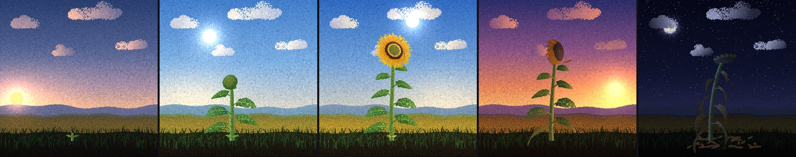

<br clear="right">

<a id="lotus"></a>
### Lotus

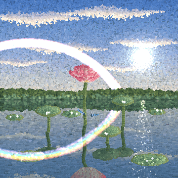

| | |
|---|---|
| **File** | [`animations/garden/lotus.py`](../animations/garden/lotus.py) |
| **Class** | `Lotus` |
| **Length** | 60 s, story, plays once |
| **`--png` stages** | 6, 20, 33, 46, 57 s |
| **Preview clip** | 30-35 s |

Rain hisses on a grey pond and rings spread across the water. Rolled lotus pads unfurl
on the surface; others rise on stalks, cupped like bowls, holding beads of water. A bud
pushes up out of the pond. The rain stops, the clouds open, a rainbow hangs over the far
trees, and everything doubles in the still water. The lotus opens - pink-tipped petals
around a ring of golden stamens and a green seed pod - dragonflies dart in and a koi
slides by under the surface. As the sun goes down the petals let go one by one and float
away, leaving the seed pod nodding over its own reflection.

```bash
python animations/garden/lotus.py
python animations/garden/lotus.py --png
```

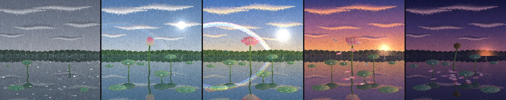

<br clear="right">

<a id="sakura"></a>
### Sakura

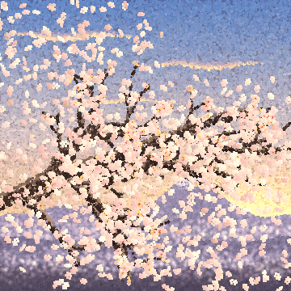

| | |
|---|---|
| **File** | [`animations/garden/sakura.py`](../animations/garden/sakura.py) |
| **Class** | `Sakura` |
| **Length** | 60 s, story, plays once |
| **`--png` stages** | 5, 17, 31, 45, 57 s |
| **Preview clip** | 46-51 s |

A winter night: snow falls on a bare, gnarled branch under the moon and settles along
its upper edges. Dawn comes, the snow melts away and the buds swell, red then pink.
Blossoms burst open in a wave from the trunk out to the twig tips until the branch is
clouded in pink, and a white-eye drops in to hop from cluster to cluster. Then the wind
rises: the bird flees, the petals tear loose and whirl across the golden afternoon in
a blizzard, and by sunset fresh bronze-green leaves are unfolding where the flowers were.

```bash
python animations/garden/sakura.py
python animations/garden/sakura.py --png
```

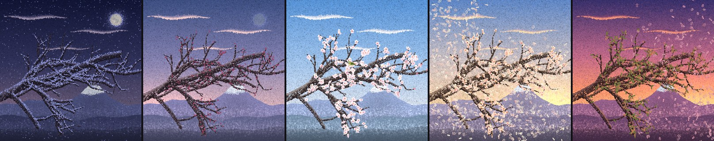

<br clear="right">

<a id="koi-pond"></a>
### Koi pond

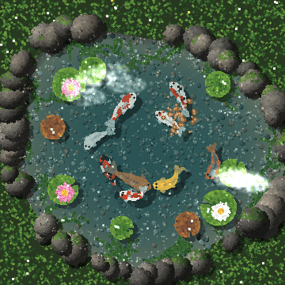

| | |
|---|---|
| **File** | [`animations/garden/koi_pond.py`](../animations/garden/koi_pond.py) |
| **Class** | `KoiPond` |
| **Length** | 60 s, seamless loop |
| **`--png` stages** | 6, 14, 23, 41.5, 50 s |
| **Preview clip** | 19-24 s |

Sunlight wobbles in a net of light over the pebbles on the bottom while nine koi -
kohaku, sanke, showa, ogon, platinum, tancho, asagi, chagoi - cruise in slow loops,
their shadows gliding beneath them. Water lilies open among the pads. A handful of food
lands on the water and the koi swarm in, gulping at the surface, then drift apart again.
A maple leaf spins down and floats, a dragonfly skims across and taps the surface,
clouds slide over the reflection, and the lilies close as the minute comes round.

```bash
python animations/garden/koi_pond.py
python animations/garden/koi_pond.py --png
```

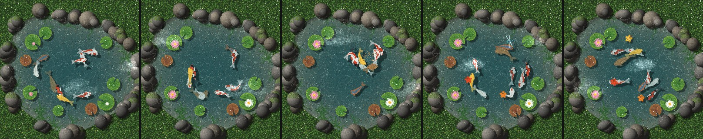

<br clear="right">

<a id="fireflies"></a>
### Firefly meadow

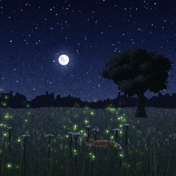

| | |
|---|---|
| **File** | [`animations/garden/fireflies.py`](../animations/garden/fireflies.py) |
| **Class** | `Fireflies` |
| **Length** | 60 s, story, plays once |
| **`--png` stages** | 5, 18, 31.4, 43, 55.75 s |
| **Preview clip** | 41-46 s |

The sun has just gone. The sky still burns orange behind a line of trees and a lone oak,
and the tall grass sways dark against it. One by one fireflies wake and blink in the grass.
Through the blue hour there are more and more, and their flashes begin to fall into step:
waves of light roll across the meadow until the whole field flashes as one. The moon comes
up through the trees, a fox trots through the grass - pausing to look straight at you, eyes
shining - and the fireflies lift out of its way.

```bash
python animations/garden/fireflies.py
python animations/garden/fireflies.py --png
```

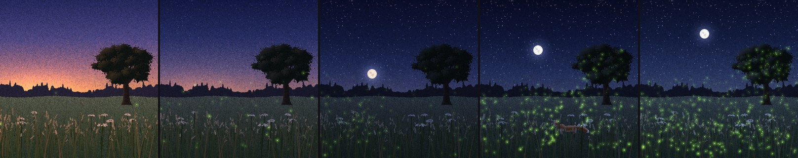

<br clear="right">

<a id="glow-beach"></a>
### Glowing beach

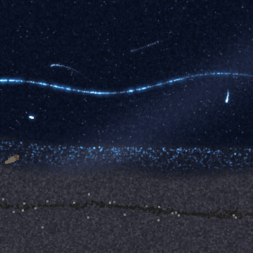

| | |
|---|---|
| **File** | [`animations/garden/glow_beach.py`](../animations/garden/glow_beach.py) |
| **Class** | `GlowBeach` |
| **Length** | 60 s, seamless loop |
| **`--png` stages** | 8.9, 11.6, 19.6, 30.4, 40.6 s |
| **Preview clip** | 8-13 s |

There is no moon. Out on the black water a swell line comes in, steepens, and as it breaks
the plankton in it light up: a seam of electric blue peels along the wave, the white water
fizzes with sparks, and the sheet of water slides up the sand with a glowing lip before it
drains back, leaving the wet sand twinkling. The wet sand is a mirror for the Milky Way.
Fish dart through the shallows drawing streaks of light. Someone walks the waterline with a
dog that keeps charging into the surf; every footprint flashes blue as it is pressed into
the sand, and the next wave washes the prints away.

```bash
python animations/garden/glow_beach.py
python animations/garden/glow_beach.py --png
```

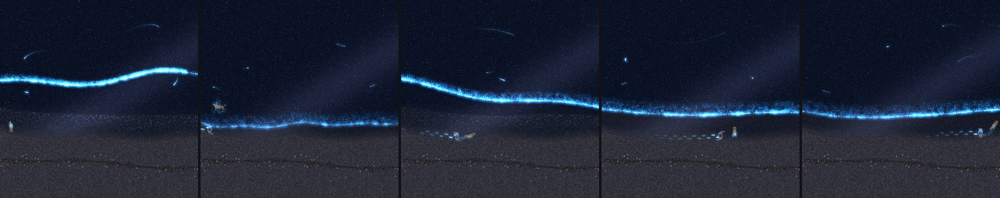

<br clear="right">

<a id="aurora"></a>
### Northern lights

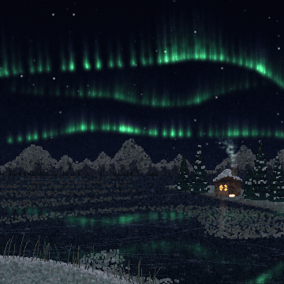

| | |
|---|---|
| **File** | [`animations/garden/aurora.py`](../animations/garden/aurora.py) |
| **Class** | `Aurora` |
| **Length** | 60 s, story, plays once |
| **`--png` stages** | 5, 21, 33, 50.6, 57.5 s |
| **Preview clip** | 47-52 s |

A still, bitter night. A cabin on the shore has one lit window and a thread of chimney smoke;
the lake is black ice dusted with snow, and the stars turn slowly overhead. A faint green arc
lifts over the mountains, brightens, and folds into a curtain whose rays ripple and pleat, with
violet along its top. A second curtain joins it and everything below - the snow, the ice, the
cabin roof - takes on their green. Snow blows across the ice. Then the sky lets go: the curtain
surges overhead, its lower edge burns pink and rays pour down from straight above in a crown,
before it all breaks into soft patches that pulse on and off as the night settles.

```bash
python animations/garden/aurora.py
python animations/garden/aurora.py --png
```

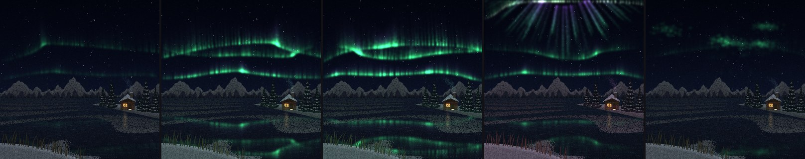

<br clear="right">

<a id="kelp"></a>
### Kelp forest

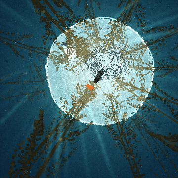

| | |
|---|---|
| **File** | [`animations/garden/kelp.py`](../animations/garden/kelp.py) |
| **Class** | `Kelp` |
| **Length** | 60 s, seamless loop |
| **`--png` stages** | 8, 22, 30.6, 33.2, 47 s |
| **Preview clip** | 28-33 s |

We are lying on the sea floor looking up. Giant kelp rises on every side, its stalks
converging toward the bright circle where the sky shows through the surface, golden blades
glowing where the light comes through them and leafy mats floating overhead. Sunbeams fan
down and shift as swells pass. A silver school of fish turns in a slow ring. A seal comes
diving out of the canopy straight through them - the school bursts apart and flows back
together behind it - and a sea otter floats on its back in the light, paws busy. Bubbles
wobble up, specks drift, and a pair of bright orange fish weave between the stalks.

```bash
python animations/garden/kelp.py
python animations/garden/kelp.py --png
```

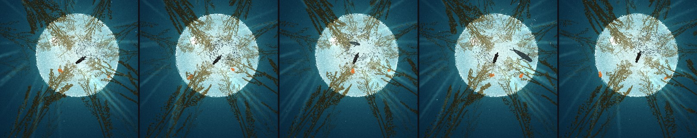

<br clear="right">

<a id="night-bloom"></a>
### Queen of the Night

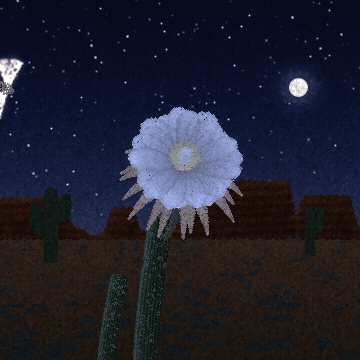

| | |
|---|---|
| **File** | [`animations/garden/night_bloom.py`](../animations/garden/night_bloom.py) |
| **Class** | `NightBloom` |
| **Length** | 60 s, story, plays once |
| **`--png` stages** | 3, 16, 27, 36.5, 56.5 s |
| **Preview clip** | 31-36 s |

The sun has gone down behind the red rock and the desert turns blue. On a ribbed cactus a
long-tubed bud lifts and swells. Stars come out, the moon climbs, and the bud slowly opens:
the bronze outer petals peel back like rays, the white inner petals spread into a wide cup,
and a crown of cream stamens and a starry stigma rise from it, glowing in the moonlight. A
hawk moth comes whirring in, hovers, and drinks from the flower with its long tongue, dusted
with pollen. By the time the sky pales in the east the moon has set; the first sun turns
the tops of the mesas red, and the flower, its night over, folds and droops.

```bash
python animations/garden/night_bloom.py
python animations/garden/night_bloom.py --png
```

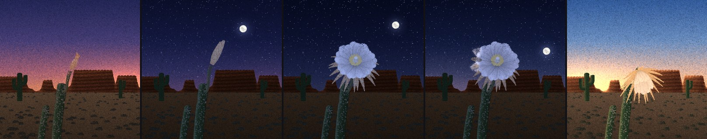

<br clear="right">

<a id="black-hole"></a>
### Black hole

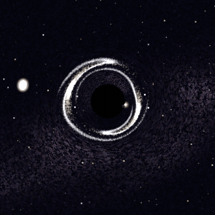

| | |
|---|---|
| **File** | [`animations/garden/black_hole.py`](../animations/garden/black_hole.py) |
| **Class** | `BlackHole` |
| **Length** | 60 s, story, plays once |
| **`--png` stages** | 10.8, 15, 26.6, 42, 50 s |
| **Preview clip** | 8-13 s |

A black hole sits in front of the Milky Way, invisible except for what it does to the light
behind it: stars slide round it in arcs and doubled images, and as a distant spiral galaxy
drifts exactly behind it, the galaxy is drawn out into a full Einstein ring. Then a star like
the Sun comes falling in. As it swings past it is stretched long, and at its closest it is
torn apart - spaghettified - into a glowing stream. Half the stream is flung away for good;
the other half arcs out, bent into ghostly arches by the hole's gravity, and comes falling
back. Where it crashes into itself there is a flash, and a ring of that light sweeps out
through the dust around the hole. The returning gas winds into a blazing disk - its near
side brighter, rushing toward us - with a thin ring of light hugging the shadow and the far
side of the disk lifted into an arch over the top. Jets punch out of the poles. Last, a
little probe falls in, its beacon blinking slower and slower and redder and redder, until
it freezes at the edge of the dark and fades away.

```bash
python animations/garden/black_hole.py
python animations/garden/black_hole.py --png
```

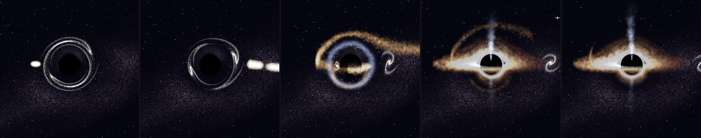

<br clear="right">

<a id="golden-hour"></a>
### Golden hour

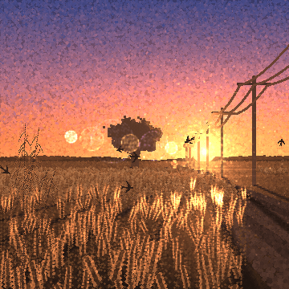

| | |
|---|---|
| **File** | [`animations/garden/golden_hour.py`](../animations/garden/golden_hour.py) |
| **Class** | `GoldenHour` |
| **Length** | 60 s, story, plays once |
| **`--png` stages** | 5, 20, 35, 48, 57 s |
| **Preview clip** | 45-50 s |

The sun hangs low and straight ahead, so everything is lit from behind: every wheat head
wears a rim of gold, the whiskers of the near ears glow like filaments, and dust hangs
glittering in the air. Gusts of wind run across the field toward you as rolling waves of
sheen. Shadows are impossibly long - the lone oak on the skyline, the telegraph poles and a
cyclist riding away down the farm track all lay dark stripes across the wheat that stretch
longer and longer as the sun sinks. Swallows skim the tops of the ears. The light deepens
from gold to orange to rose; the sun touches the hills and slides away, the shadows let go,
and the field sits in a pink afterglow with the first star out.

```bash
python animations/garden/golden_hour.py
python animations/garden/golden_hour.py --png
```

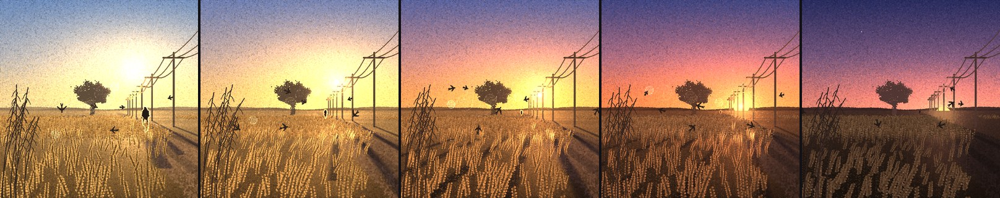

<br clear="right">

<a id="fuji"></a>
### Mount Fuji

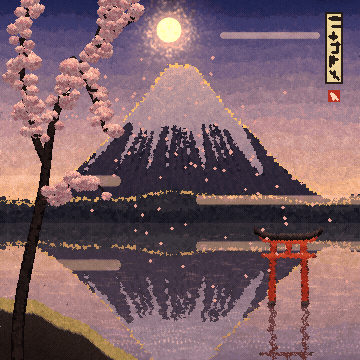

| | |
|---|---|
| **File** | [`animations/garden/fuji.py`](../animations/garden/fuji.py) |
| **Class** | `Fuji` |
| **Length** | 60 s, seamless loop |
| **`--png` stages** | 3, 17, 31, 44.6, 53 s |
| **Preview clip** | 41.5-46.5 s |

Flat bands of colour, ink key-lines and washi paper grain, with the light painted in dots.
We look west across a lake to the mountain, past a cherry tree and a vermilion torii standing
in the water, so the minute can pass through Fuji's famous faces in their true order:

  night        climbers' headlamps zigzag up the trail in a chain of sparks; paper lanterns
               drift on the lake under the Milky Way
  first light  Akafuji - the dawn turns the mountain crimson, running down from the summit
  day          a lens-shaped cap cloud (kasa-gumo) settles on the peak, a hanging cloud drifts
               beside it, cranes fly across, and when the wind drops the lake holds a perfect
               upside-down Fuji
  sunset       Diamond Fuji - the sun sinks exactly into the crater and flares like a jewel
  dusk         fireworks bloom over the lake and the water doubles every one

```bash
python animations/garden/fuji.py
python animations/garden/fuji.py --png
```

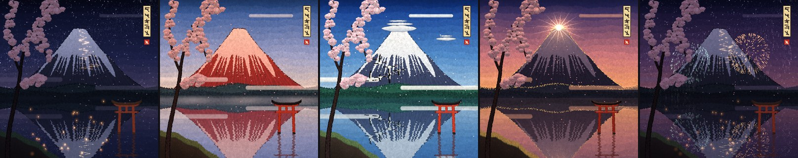

<br clear="right">

<a id="diwali"></a>
### Diwali night

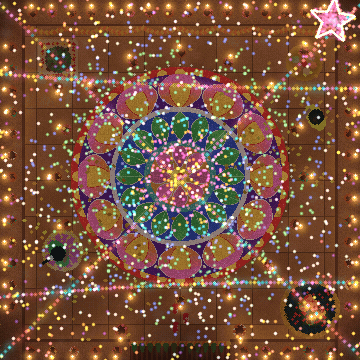

| | |
|---|---|
| **File** | [`animations/garden/diwali.py`](../animations/garden/diwali.py) |
| **Class** | `Diwali` |
| **Length** | 60 s, story, plays once |
| **`--png` stages** | 9, 22.5, 33, 44.8, 51.3 s |
| **Preview clip** | 45.5-50.5 s |

Dusk falls on a stone courtyard. In the middle a rangoli pours itself out of coloured powder,
ring by ring from the centre - a lotus, a band of kolam dots, a wreath of leaves, twelve great
petals, a scalloped border - while Lakshmi's footprints appear at the door. Then the lamps:
seventy-odd clay diyas catch one after another in chasing waves, round the rangoli, along the
ledges, in the brass urli where they float among marigolds; strings of fairy lights blink on
overhead and a paper star lantern sways in the corner. Two children run out with sparklers and
write loops of light in the air, chakris spin and spit spiral sparks, anar fountains roar up at
us, and a handful of marigold petals is flung high and comes down everywhere. Then the rangoli
itself rises: its powder lifts off as glowing motes and spirals up past us - and bursts overhead
as fireworks in its own colours, each flash washing the courtyard pink, green, gold. Embers rain
down onto the pattern and it glows, ring after ring, as the smoke drifts and the lamps burn on.

```bash
python animations/garden/diwali.py
python animations/garden/diwali.py --png
```

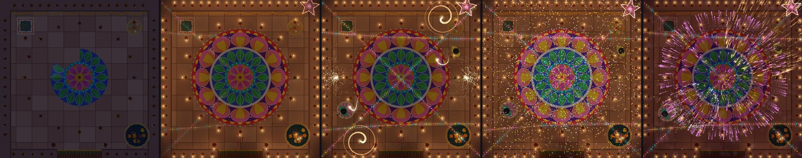

<br clear="right">

## Neon

Cyberpunk, synthwave and dieselpunk cities, built on the engine plus the Neon toolkit.

<a id="neon-alley"></a>
### Neon alley

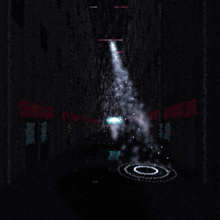

| | |
|---|---|
| **File** | [`animations/neon/neon_alley.py`](../animations/neon/neon_alley.py) |
| **Class** | `NeonAlley` |
| **Length** | 60 s, story, plays once |
| **`--png` stages** | 8, 25.4, 29.2, 33.6, 52 s |
| **Preview clip** | 29.5-34.5 s |

Night, rain. A narrow alley runs between towering blocks to a gap of glowing sky where a
megatower's giant screen plays. Stacked signs in pink and cyan buzz and stutter on the walls,
red lanterns sway on the cables, steam rolls from a vent and a manhole, and every puddle
holds a broken, trembling copy of it all. A police drone drifts overhead sweeping its
searchlight through the rain while someone walks slowly toward you under a clear umbrella
with a glowing rim. Then the power surges: the signs stutter, and the whole district goes
black - lightning, the drone's beam and the umbrella the only light - until the city comes
back on block by block, rushing up the alley toward you in a cascade of neon.

```bash
python animations/neon/neon_alley.py
python animations/neon/neon_alley.py --png
```

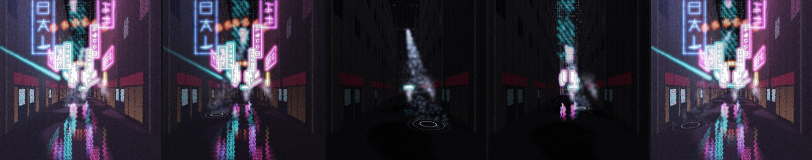

<br clear="right">

<a id="holo-sakura"></a>
### Hologram sakura

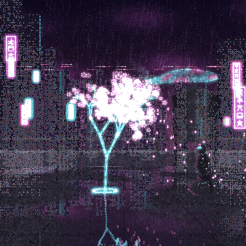

| | |
|---|---|
| **File** | [`animations/neon/holo_sakura.py`](../animations/neon/holo_sakura.py) |
| **Class** | `HoloSakura` |
| **Length** | 60 s, story, plays once |
| **`--png` stages** | 6, 16, 30, 45.8, 55 s |
| **Preview clip** | 44-49 s |

Rain on a rooftop high above the megacity. A projector on the wet concrete flickers awake and
throws up a cherry tree made of light: the trunk and branches draw themselves upward in cyan
scanlines, then blossoms burst open in a wave of pink. Pixel petals peel away on the wind,
fall through the rain and fizzle into sparks on the puddles, where the whole tree trembles
upside down. Beyond the parapet the towers glitter, flying traffic streams between them and a
giant holographic koi swims through the skyline. Someone sits on a crate watching. The signal
breaks up - the tree glitches, splits into colours, drops to a wireframe - then surges back
brighter than before, throwing petals into a storm.

```bash
python animations/neon/holo_sakura.py
python animations/neon/holo_sakura.py --png
```

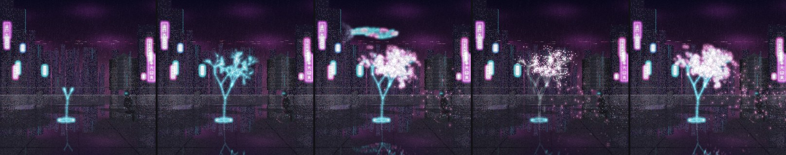

<br clear="right">

<a id="synthwave-drive"></a>
### Synthwave drive

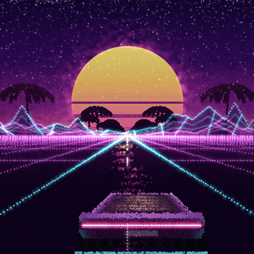

| | |
|---|---|
| **File** | [`animations/neon/synthwave_drive.py`](../animations/neon/synthwave_drive.py) |
| **Class** | `SynthwaveDrive` |
| **Length** | 60 s, seamless loop |
| **`--png` stages** | 3, 12.38, 24, 41.3, 50 s |
| **Preview clip** | 10-15 s |

A low wedge of a car races down a straight highway toward a huge sun banded in gold and hot
pink, sinking behind wireframe mountains. A magenta grid rushes under the wheels, cyan lines
mark the road's edges, palms flick past on both sides and the glossy road throws back a long
pink streak of the sun. The car's tail-light bar burns across its back, a cyan underglow
spills onto the asphalt, and it drifts from lane to lane. Stars prick the violet sky and out
at the edges, storm clouds over the desert flicker with lightning.

```bash
python animations/neon/synthwave_drive.py
python animations/neon/synthwave_drive.py --png
```

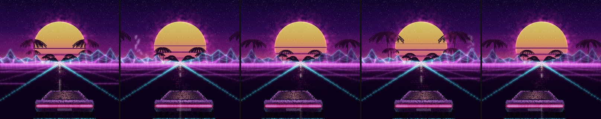

<br clear="right">

<a id="zeppelin-harbor"></a>
### Zeppelin harbour

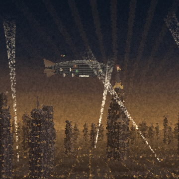

| | |
|---|---|
| **File** | [`animations/neon/zeppelin_harbor.py`](../animations/neon/zeppelin_harbor.py) |
| **Class** | `ZeppelinHarbor` |
| **Length** | 60 s, story, plays once |
| **`--png` stages** | 6, 22, 36, 48.3, 56 s |
| **Preview clip** | 44-49 s |

Dusk over an art-deco metropolis choked in amber smog. Stepped towers bristle with fins and
spires, their windows burning in long vertical bands; smokestacks pour plumes lit orange by
the furnaces under them; rays of light fan up behind the tallest tower like an old poster.
Out of the haze comes an enormous riveted airship, droning, its engines' propellers a blur,
escorted by circling fighters. The city's searchlights find it and follow it in. It swings
broadside, turns, and creeps nose-first to the mooring mast on top of the great tower -
locks on in a burst of sparks - the mast's beacons turn green, and every searchlight in the
city crosses on it in salute.

```bash
python animations/neon/zeppelin_harbor.py
python animations/neon/zeppelin_harbor.py --png
```

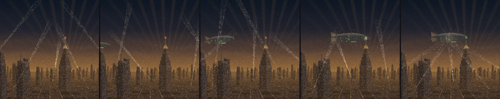

<br clear="right">

<a id="iron-streamliner"></a>
### Iron streamliner

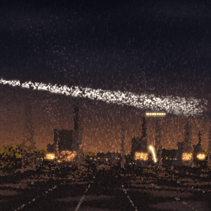

| | |
|---|---|
| **File** | [`animations/neon/iron_streamliner.py`](../animations/neon/iron_streamliner.py) |
| **Class** | `IronStreamliner` |
| **Length** | 60 s, story, plays once |
| **`--png` stages** | 4, 12, 24, 40, 57 s |
| **Preview clip** | 8-13 s |

Drizzle over a mill town. Down in the valley the blast furnaces pour and glow, lighting the
smoke and the underside of a long steel trestle that strides across on lattice legs. A
headlight swells in the dark at the left: an art-deco streamliner, all riveted armour plate
and chrome speed-stripes, thunders onto the bridge, its beam cutting a cone through the rain,
smoke rolling back from its stack, sparks spitting from the wheels. The carriages follow,
windows warm, past us and away across the valley, until only the red lamp on the last car is
left, shrinking into the night. A blimp drifts over the far hills, a ribbon of lights running
along its flank.

```bash
python animations/neon/iron_streamliner.py
python animations/neon/iron_streamliner.py --png
```

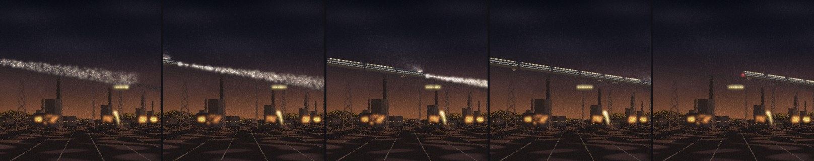

<br clear="right">

## Dandelion

<a id="dandelion"></a>
A self-contained pointillist dandelion (it does not use the shared engine), at three times of day.

| Night | Sunset | Sunrise |
|:---:|:---:|:---:|
| 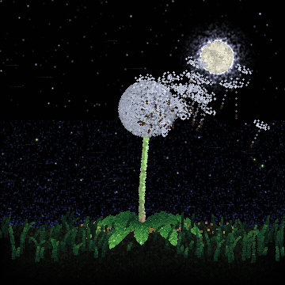 | 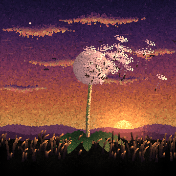 | 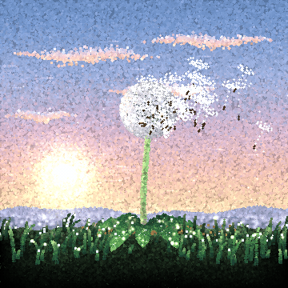 |

| | |
|---|---|
| **Files** | [`animations/dandelion/dandelion.py`](../animations/dandelion/dandelion.py), [`dandelion_sunset.py`](../animations/dandelion/dandelion_sunset.py), [`dandelion_sunrise.py`](../animations/dandelion/dandelion_sunrise.py) |
| **Length** | 54 s, story, plays once |
| **`--png` stages** | 5.5, 14.5, 25, 34.5, 41 s |

A rosette of toothed leaves unfurls, a stalk rises with a green bud, the bud opens
into a golden flower, folds shut and bows, then straightens taller and opens again
as a silver seed clock. The wind picks up and carries the seeds away, one by one.

The same plant, at three times of day:
    night     a meadow under the moon, stars and fireflies                     (default)
    sunset    a burning sky, the sun sinking behind the hills, swallows overhead,
              the plant rim-lit in orange, the first fireflies at dusk
    sunrise   a pastel dawn, light beams through mist that slowly lifts, dew
              sparkling on every leaf, blade and seed

```bash
python animations/dandelion/dandelion.py                      # night (default)
python animations/dandelion/dandelion.py --theme sunset
python animations/dandelion/dandelion_sunrise.py              # shortcut for --theme sunrise
python animations/dandelion/dandelion.py --theme sunset --png
```

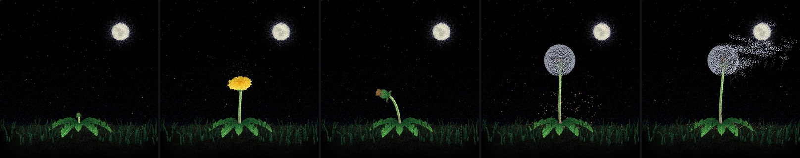
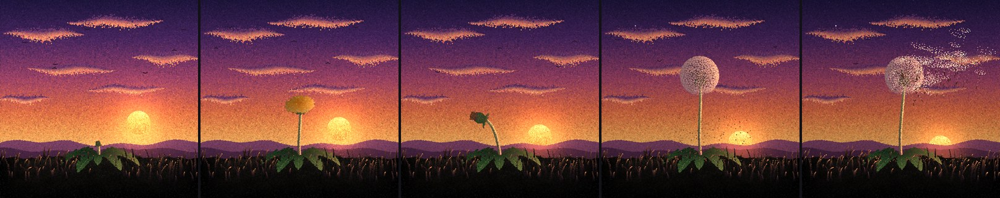
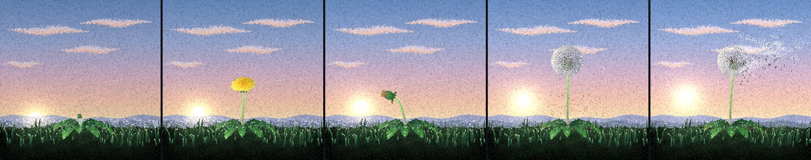

## ASCII rose

<a id="ascii-rose"></a>
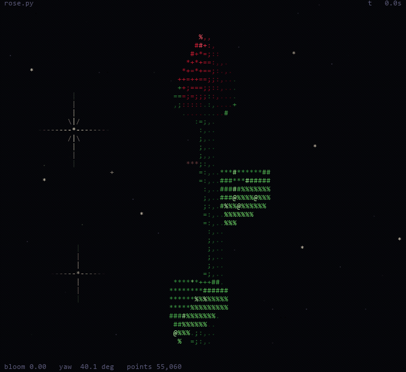

A 3D rose that blooms in your terminal, drawn in ASCII with 24-bit colour. Self-contained; needs only NumPy.

```bash
python animations/ascii-rose/rose.py                     # bloom once, then keep turning
python animations/ascii-rose/rose.py --to "Asha"         # sign it for someone ("for Asha <3")
python animations/ascii-rose/rose.py --loop              # fold back into a bud and re-bloom every ~26 s
python animations/ascii-rose/rose.py --spin 0            # hold still
python animations/ascii-rose/rose.py --snapshot 12 --size 110x50 --no-color   # print one frame and exit
```

Ctrl+C quits. Needs numpy. Looks best in a truecolor terminal (Windows Terminal,
iTerm2, most Linux terminals) with the window maximised or the font zoomed out.

How it works: the petals are one long parametric surface wound around the
centre (3.6 petals per turn). Each frame the surface is rebuilt for the current
amount of bloom, rotated, projected onto the character grid with a z-buffer,
and lit; brightness picks both the character and its colour.

| Option | Meaning |
|---|---|
| `--to NAME` | who the rose is for (default "you"; "" hides it) |
| `--loop` | fold back into a bud and re-bloom every ~26 s |
| `--spin RAD_PER_S` | turning speed (default 0.35) |
| `--fps N` | frame-rate cap (default 30) |
| `--aspect H_OVER_W` | character cell height/width (default 2.0) |
| `--no-hud` | hide the corner readouts |
| `--no-color` | plain characters, no colour |
| `--snapshot SECONDS` | print the frame at this time and exit |
| `--size WxH` | frame size for `--snapshot` (default: terminal size) |

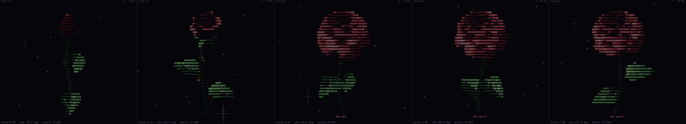

<br clear="right">
