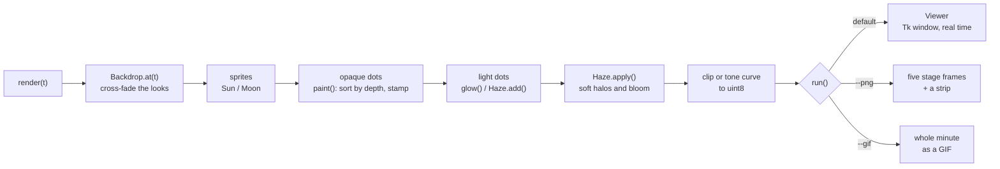

# The engine

Every pointillist animation in this repository is drawn by one small shared engine,
[`engine/pointillism.py`](../engine/pointillism.py). The Neon set adds a thin toolkit on top of it,
[`animations/neon/neon.py`](../animations/neon/neon.py). The dandelion and the ASCII rose are
self-contained and do not use either.

- [The idea](#the-idea)
- [Anatomy of a scene](#anatomy-of-a-scene)
- [One frame, step by step](#one-frame-step-by-step)
- [API reference](#api-reference)
- [The Neon toolkit](#the-neon-toolkit)
- [Seamless loops](#seamless-loops)
- [Why it is fast enough](#why-it-is-fast-enough)
- [Writing a new scene](#writing-a-new-scene)

## The idea

Everything is drawn as dots. A frame is a floating-point RGB image (`H x W x 3`, values
roughly 0-255 but allowed to run higher before the final clip or tone curve). Two kinds of
dot are put onto it:

| Kind | Function | Behaviour | Used for |
|---|---|---|---|
| **Opaque dots** | `stamp`, `paint` | each dot replaces the pixels under it; `paint` sorts groups by depth and draws far to near | petals, leaves, bark, fish, buildings, people |
| **Light dots** | `glow`, `lights`, `Haze` | each dot *adds* light, fading toward its edge, so overlapping light builds up | sun glare, fireflies, neon, sparks, fireworks, reflections |

There is no physics simulation and no state carried from one frame to the next:
`render(t)` computes the whole picture for time `t` directly. That is what lets the
window jump, restart instantly, and export any moment or the whole film deterministically.

## Anatomy of a scene

Each animation is one Python file holding one class and a `run(...)` call:

```python
T_END = 60.0                                   # length in seconds
STAGES = [5.0, 18.0, 31.4, 43.0, 55.75]        # the five moments --png saves

class Fireflies:
    def __init__(self, W, H):                  # build everything that never changes, once
        ...
    def render(self, t):                       # return an (H, W, 3) uint8 frame for time t
        ...

if __name__ == "__main__":
    run(Fireflies, "Firefly meadow", "fireflies", T_END, STAGES)          # story: plays once, then holds
    # run(KoiPond, "Koi pond", "koi_pond", T_END, STAGES, wrap=True)    # loop: time wraps round
```

`__init__` usually builds:

- **Backdrops**: a few complete background images, one per "look" (dawn, noon, dusk...),
  built from the same random seed so their dots line up, then cross-faded per frame with
  `Backdrop.at(t)`.
- **Geometry**: arrays of dot positions, colours and parameters for every moving part
  (petals as ruled surfaces, stems as Bezier curves, fish along their own path history,
  particles with fixed launch values).
- **Sprites and masks**: `Sun`/`Moon` discs, sky masks so the sun hides behind hills,
  precomputed light maps.

`render(t)` then follows the timeline with smooth "dials" built from `ss` (smoothstep) and
`keyed` (interpolation between `(time, value)` keys), moves the geometry, and paints it.

## One frame, step by step



## API reference

<details>
<summary><b>Easing and interpolation</b></summary>

| Function | What it does |
|---|---|
| `ss(x, a, b)` | Smoothstep from 0 at `a` to 1 at `b` (works on arrays). The basic timeline dial. |
| `keyed(t, keys)` | Smoothly interpolates a value (number, colour, vector) between `(time, value)` keys. |
| `unit(v)` | Normalises a vector. |
| `bezier(P, s)` | Point and tangent along a cubic Bezier at parameters `s`. |
| `mix(a, b, w)` | Per-row blend of two colour arrays. |

</details>

<details>
<summary><b>Dots and light</b></summary>

| Function | What it does |
|---|---|
| `stamp(img, x, y, col, rad)` | Opaque round dots of radius up to 3 px; later dots cover earlier ones. |
| `glow(img, x, y, col, rad)` | Additive soft dots that fade toward their edge. |
| `paint(img, dots)` | Draws groups of `(x, y, colour, radius, depth)` far to near. |
| `lights(img, groups)` | Draws groups of `(x, y, colour, radius)` as light. |
| `lit(col, x, y, ox, oy, size, resp, light, wash)` | Low-sun shading: ambient tint in shadow, a warm rim on the side facing the light, `wash` for thin translucent parts. |
| `class Haze(W, H, k)` | Soft light gathered on a coarse grid (`k` times smaller) and smoothed up: halos, bloom, beams, mist. `add()` splats with a soft footprint, `splat()` drops light into the nearest cell (very cheap), `apply()` blurs, upsamples and adds it, optionally through a mask. |

</details>

<details>
<summary><b>Colour and sampling</b></summary>

| Function | What it does |
|---|---|
| `shades(rng, pal, g, spread, jitter)` | A colour per dot from a palette, guided by `g` in [0, 1] with randomness. |
| `gradient(stops, g)` | Colour at heights `g` from `(height, colour)` stops. |
| `sample_u(rng, n, width)` | Positions along a shape, denser where it is wider, so fills look even. |
| `sample_v(rng, n, rim)` | Positions across a shape, with extra density at the rim. |
| `shuffle`, `join` | Shuffle / concatenate dictionaries of parallel arrays. |

</details>

<details>
<summary><b>Backdrops and sky</b></summary>

| Function / class | What it does |
|---|---|
| `sky(W, H, rng, stops, bottom, density)` | A stippled vertical gradient image. |
| `warm_glow(img, cx, cy, R, col, squash)` | A smooth coloured haze, e.g. round a low sun. |
| `stars(img, rng, n, ymax, b)` | A star field at brightness `b`. |
| `moon(img, rng, mx, my, mr, b)` | A moon with seas and a halo. |
| `cloud_streaks(...)`, `cloud_puffs(...)` | Long thin clouds lit from below; heaped clouds lit from the side facing the light. |
| `hill_layers(img, rng, layers, bottom)` | Stippled rolling hills, back to front; returns each layer's top line. |
| `class Backdrop(times, images)` | Key images cross-faded per frame: `at(t)`. |
| `class Sun(rng, R, reach)` | A textured disc with a wide glow, coloured when drawn: `draw(img, sx, sy, core, glow_col, disc_mask, glow_mask)`. |
| `class Moon(rng, R, reach)` | The `Sun` sprite with seas and a quieter halo. |

</details>

<details>
<summary><b>Window and exports</b></summary>

| Function / class | What it does |
|---|---|
| `run(make, title, prefix, t_end, stages, argv=None, loop=False, wrap=False)` | The entry point every scene calls: the window by default, `--png` or `--gif`. `wrap=True` marks a seamless loop. |
| `class Viewer` | The Tk window: a square ~92% of the screen height, playing in real time. Keys: Space pause, R restart, S save the current frame as `<prefix>_frame.png`, Esc quit. |
| `save_png(make, prefix, stages)` | Renders the five stages at 1000 x 1000 to `<prefix>_1.png` ... `<prefix>_5.png`, plus `<prefix>_stages.png` (2500 x 500). |
| `save_gif(make, prefix, t_end, fps=12, size=640, wrap=False)` | The whole film as a 640 x 640, 12 fps GIF. For loops the end frame is left out so it repeats cleanly. |

</details>

## The Neon toolkit

[`animations/neon/neon.py`](../animations/neon/neon.py) adds what the city scenes need:

| Name | What it does |
|---|---|
| `Cam(W, H, vx, vy, f, hc)` | A pinhole camera looking along +z (`proj(X, Y, z)`), with the eye `hc` above the ground. |
| `Lights(W, H, k)` | Collects a frame's light and lays it down in three layers: crisp cores (`add`), a soft halo grid (`soft`) and a wide bloom; `tube()` draws a neon tube (hot core + coloured halo + bloom). |
| `tone_lut(exposure, shoulder)` and `finish(img, lut)` | A soft shoulder for very bright light, so neon cores go white while halos keep their colour. |
| `glyph`, `sign_strokes`, `stroke_points` | Invented characters for signs (deliberately not real words). |
| `flicker(t, seed, rate, broken)` | A tube's hum, with stutters when `broken > 0`. |
| `NEON` | The palette: pink, magenta, cyan, blue, violet, amber, red, green, white. |

Some Garden scenes (`black_hole.py`, `diwali.py`) carry their own small tone curve in the
same spirit.

## Seamless loops

`glow_beach`, `kelp`, `koi_pond`, `fuji` and `synthwave_drive` loop forever. They pass
`wrap=True` to `run()`, and every motion in them is periodic over the minute: frequencies are
whole numbers of cycles per 60 s (`TAU * n * t / 60`), paths are closed, and one-off events
start and finish inside the loop. As a check, the frame at `t = 0` and the frame just before
`t = 60` were compared for each loop while it was being made: on average they differ by about
one 8-bit level or less, smaller than the change between two ordinary consecutive frames.

## Why it is fast enough

Everything is NumPy, with no per-dot Python loops in the hot paths:

- **Dot footprints** come from a precomputed table of pixel offsets sorted by distance, so a
  batch of dots becomes one array of pixel indices.
- **Opaque dots** are written as whole 12-byte RGB records (`np.void` views), which scatters
  about three times faster than writing three float channels.
- **Light** is summed with `np.bincount` over the touched rectangle when dots are dense and
  `np.add.at` when they are sparse.
- **Soft light** (`Haze`) is gathered on a grid 2-6x coarser than the frame, blurred with a
  separable [1 2 1] filter, and upsampled only over the rows and columns that hold light.
- **Static work is hoisted**: backdrops, light maps and anything that never changes are
  built once in `__init__` (e.g. `diwali.py` caches its fully lit floor once every lamp is lit).

See [Performance](../README.md#performance) for measured frame times.

## Writing a new scene

[`examples/minimal_scene.py`](../examples/minimal_scene.py) is a complete, runnable
template (about 60 lines): a two-look backdrop, a setting sun, opaque grass and blinking
fireflies. Copy it into `animations/<set>/`, change the `sys.path` line if the depth of the
folder changes, and grow it from there. Rules of thumb that every scene here follows:

1. Build once in `__init__`, keep `render(t)` free of state.
2. Seed every random generator, so frames are repeatable and backdrops line up.
3. Drive the story with `ss()` dials and `keyed()` keys instead of `if` jumps.
4. Draw far to near with `paint()`, then add light.
5. Scale sizes with the frame (`S = min(W, H)`), so `--png` (1000 px), `--gif` (640 px)
   and the window all look alike.
